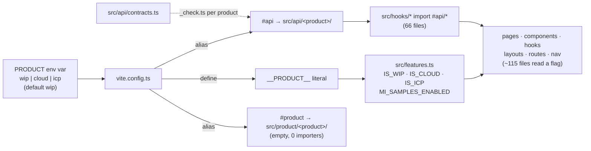
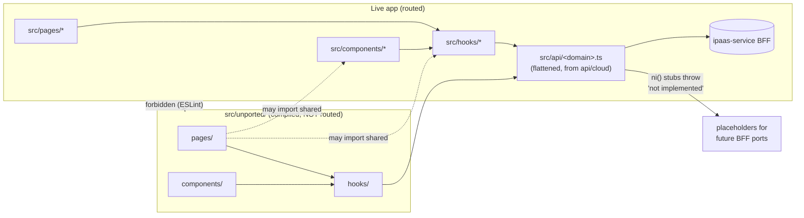
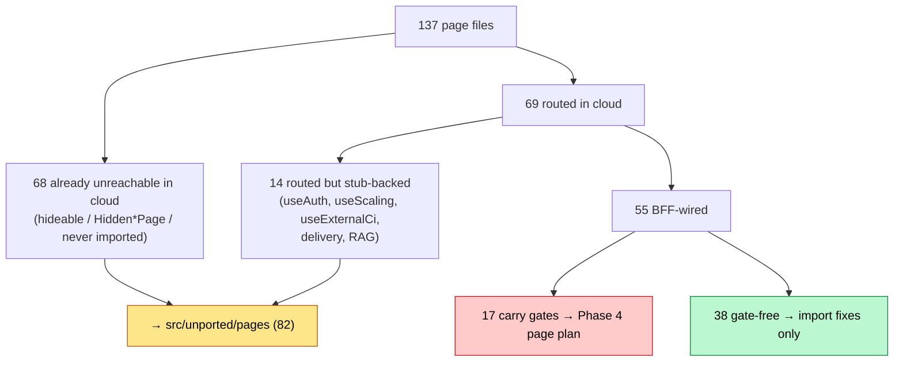
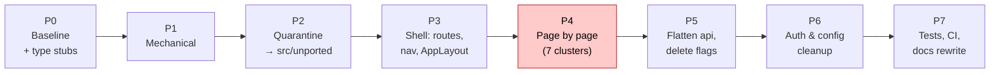
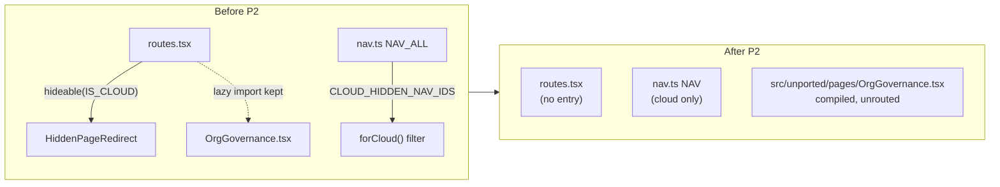
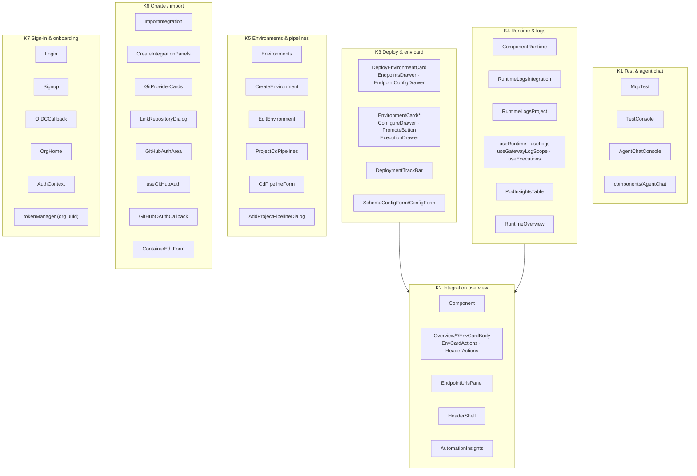
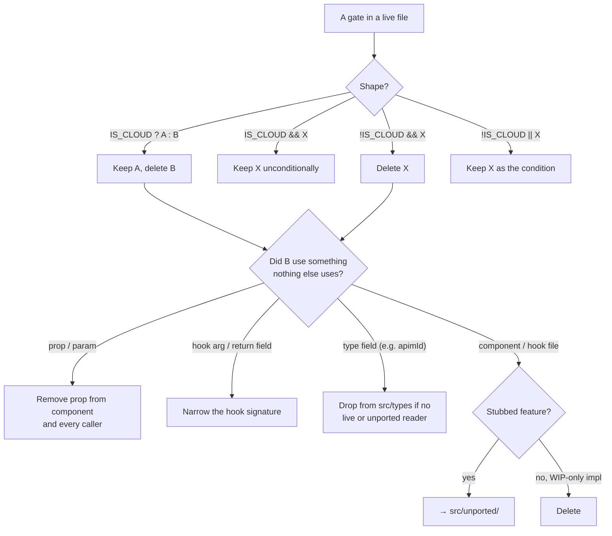

# Cloud-only refactor: removing WIP / ICP gating

> Status: **draft plan, for discussion. No code has changed.**
> Scope: `integration-control-plane/ipaas` (the console SPA).
> Numbers below were measured on this checkout (`icp2`, branch `docs/product-separation` @ `1c9acde4e`) on 2026-10-05 by
> (a) a `PRODUCT=cloud` production build, (b) a static import graph of `src/`, and
> (c) a `tsc` run with `#api` pointed at `src/api/cloud`.

---

## 1. Goal in one paragraph

Today one source tree builds three products (`wip`, `cloud`, `icp`) by picking an API folder at build time and
sprinkling `IS_WIP` / `IS_CLOUD` / `IS_ICP` checks through the UI. We keep **only cloud**:

- Every live page talks to the ipaas-service BFF.
- Features that cloud cannot serve yet keep their UI, but in a quarantine folder `src/unported/`, backed by the existing `ni()` stubs.
- The end state has **no** `IS_*` flags, no `__PRODUCT__`, no `PRODUCT` env var, no `#api` / `#product` aliases, no `contracts.ts`, and no docs that describe gating.

---

## 2. How gating works today



Three API implementations exist side by side:

| Folder | Files | Lines | What it is |
|---|---|---|---|
| `src/api/wip/` | 56 | ~7.2k | Choreo v2: GraphQL, APIM, STS, user-mgt |
| `src/api/cloud/` | 64 | ~6.2k | ipaas-service BFF. **200 real functions, 266 `ni()` stubs** |
| `src/api/icp/` | 50 | ~1.9k | Almost all stubs |

### Four facts that shape the whole plan

1. **The compiler has never checked the UI against cloud.** `tsconfig.app.json` and `vitest.config.ts` both resolve `#api/*` to `src/api/wip/*`, and `build:check` builds `PRODUCT=wip`. Pointing `#api` at cloud yields **314 `tsc` errors**. 196 of them (62%) are in files that will move to `src/unported/`; the other 118 are in files that stay live. Most come from one cause (fact 2).
2. **Cloud stubs are typed `(...args: unknown[]): never`.** That type satisfies the contracts, because `never` is assignable to anything. It breaks every consumer: `.then` on `never`, and `data` becomes implicitly `any` (211 × TS2339, 38 × TS7006). Before `contracts.ts` can go, each stub needs its **real signature**, copied from the contract.
3. **Cloud reaches into the WIP folder.** `src/api/cloud/_client.ts` re-exports `withStsRetry`, `withScopeRetry` and `obsClient` from `../wip/httpClients`. These must move before `api/wip/` can be deleted.
4. **Hiding is done by redirecting, not removing.** `hideable(IS_CLOUD, …)` in `routes.tsx` (17 blocks) swaps hidden pages for `HiddenPageRedirect`, and `nav.ts` filters `NAV_ALL` with `CLOUD_HIDDEN_NAV_IDS`. So 68 pages are already unreachable in cloud, yet still compiled and bundled.

---

## 3. Target shape



### Rules for `src/unported/`

- It mirrors `src/`: `unported/pages/`, `unported/components/<Feature>/`, `unported/hooks/`, plus `utils/` and `constants/` where needed.
- **One-way imports.** Code in `unported/` may import live code. Live code must **never** import `unported/`. This is enforced with ESLint `no-restricted-imports` (pattern `**/unported/**`) on everything outside `src/unported/`.
- It stays inside `tsconfig` `include`, so `tsc` keeps it compiling and it does not rot.
- **No routes and no nav entries.** These pages redirect today, so users lose nothing. A URL that used to redirect will fall to the app's catch-all instead. Phase 3 decides whether that catch-all redirects to the level's Overview, as `HiddenPageRedirect` does today.
- Its API functions stay in `src/api/<domain>.ts` as typed `ni()` stubs. **Porting a feature** means implementing the stubs, then moving the page and its files back out of `unported/` with a route and a nav entry.

### Final API layout ("flatten")

```
src/api/
  _client.ts        ← from api/cloud (+ createHttpClient, withStsRetry, withScopeRetry, obsClient pulled in)
  _visibility.ts, _environmentShape.ts, *.test.ts
  alerts.ts         ← all-stub domain, signatures typed
  builds.ts         ← real BFF domain
  …                 one file per domain, same names as today
```

- Hooks change `from '#api/builds'` to `from '../api/builds'` (80 import lines in 66 files).
- `contracts.ts`, every `_check.ts`, `api/wip/`, `api/icp/`, and `api/cloud/index.ts` (barrel, unused in the bundle) are deleted.
- The layering rule stays the same: pages and components go through hooks, hooks go through `api/`, and `api/` goes through `auth/tokenManager`.

---

## 4. Inventory: where every page lands



- **The 14 routed but stub-backed pages:**
  - `AccessControl`, `RoleDetail`, `ProjectRoleDetail`, `ComponentRoleDetail`, `ProjectGroupDetail`, `ComponentGroupDetail` and `ForceChangePassword` sit on `useAuth`, which is 34/34 stubs in cloud.
  - `ComponentScaling` and `ComponentExternalCI` use hooks gated `return IS_WIP`, so they are always off in cloud.
  - `DeliveryInsights` and `ConfigureDelivery` use `useDeliveryInsights`, which is all stubs.
  - `SetupRagIngestion`, `SetupRagService` and `RagRetrieval` are gated by `isRagIngestionEnabled()`, which is `IS_WIP && …`, and are nav-hidden.
- **The 38 gate-free BFF pages** (no Phase 4 entry needed): `Build`, `Deploy`, `OrgBuild`, `OrgDeploy`, `OrgTest`, `ProjectBuild`, `ProjectDeploy`, `ProjectTest`, `Projects`, `Project`, `ProjectsRedirect`, `ProjectOverview`, `ProjectSettings`, `OrgSettings`, `OrgDetails`, `OrgPackageRegistries`, `OrgDataPlanes`, `OrgCdPipelines`, `CdPipelineEditor`, `ComponentConfigs`, `ComponentContainers`, `ComponentHealthChecks`, `ComponentTest`, `AutomationTest`, `CloudEditorDeployment`, `CreateProject`, `ImportProject`, `CreateIntegrationOptions`, `BrowseSamples`, `BrowsePrebuiltIntegrations`, `PrebuiltIntegrationSetup`, `PrebuiltIntegrationDeploy`, `McpProxyFromApi`, `AiIntegrationBuilderView`, `RegisterOrganization`, `RuntimeLogsOrg`, `CookiePolicy`, `ComingSoon`.
  - Several of them render gated **components**, such as `Deploy` with `DeployEnvironmentCard` and `Project` with `Overview/*`. Those components are covered in Phase 4 under the cluster that owns them.

The full move lists are in the appendices: 82 pages, 232 exclusive files, and 44 files used only by WIP branches.

### Hooks by backing

Each hook is classified by its own `#api` imports:

| Backing | Hooks |
|---|---|
| **Real** (20) | useAuditLogs, useBuilds, useCloudEditor, useComponents, useConfiguration, useConsumers, useDataPlanes, useDeployPrebuiltIntegration, useDeploymentPipelines, useDeployments, useDevopsConfigs, useEnvironments, useHealthChecks, useLogs, useOrg, usePrebuiltIntegrations, useProjects, useRepository, useRuntime, useSamples |
| **Mixed** (14) | useApim, useArtifactToggles, useArtifacts, useCertificates, useConfigGroups, useExecutions, useGenaiServices, useGovernance, useMcpProxy, usePlatformServices, useRagIngestion, useTailscale, useThirdPartyServices, useWorkflows |
| **Stub only** (24) | useAlerts, useApiInsights, useAppSecurity, useAuth, useAutomationInsights, useConnections, useCopilot, useCredentials, useCustomDomains, useDataCollector, useDeliveryInsights, useEgressControl, useExternalCi, useInsights, useMarketplace, useObservabilityMetrics, useOnPremKeys, useOrgInsights, usePermissionLoader, useProjectAuthz, useProjectInsights, useScaling, useStorage, useSubscription |

Of these, **24 hooks move to `unported/hooks/` automatically in Phase 2**, because only unported pages use them (Appendix B).

Stub-only hooks that remain imported by live code after Phase 2 are:

- `useAuth`, `usePermissionLoader`, `useSubscription`, `useCopilot`, `useDataCollector`: through `AppLayout`, `ProtectedRoute` and the Copilot components.
- `useExternalCi`, `useScaling`, `useCredentials`, `useMarketplace`, `useInsights`: through gated branches in live components.

Phases 3 and 4 remove those call sites. After each phase, any of these hooks left with no live importer moves to `unported/`.

---

## 5. Phases



**Every phase is one PR and must leave cloud behaviour unchanged.**

Every PR passes this gate:

```bash
pnpm build:check   # tsc -b + build, with #api now pointing at cloud
pnpm lint
pnpm test:unit
pnpm test:e2e:cloud:anon && pnpm test:e2e:cloud   # cloud smoke
```

Then do a quick visual check of the running UI on the touched pages.

### P0 — Baseline and typed stubs (prerequisite, no behaviour change)

1. Create a branch, e.g. `refactor/cloud-only`.
2. Point the type-checker and unit tests at cloud:
   - `tsconfig.app.json` paths: `#api/*` → `./src/api/cloud/*`
   - `vitest.config.ts` alias: `#api` → `src/api/cloud`
   - `build:check`: `tsc -b && PRODUCT=cloud vite build`
3. **Type every `ni()` stub** from its contract, so the UI type-checks against cloud. For example:
   ```ts
   // before
   export const getAlertRules = (..._args: unknown[]): never => ni('getAlertRules');
   // after — signature copied from contracts.ts AlertsApi
   export const getAlertRules = (componentId: string, envId: string): Promise<AlertRule[]> => ni('getAlertRules');
   ```
   This touches 31 files and about 266 functions. It can be scripted from `contracts.ts`, then reviewed. It is the only way the contracts' type information survives Phase 5.
4. Fix the remaining **live** `tsc` errors. These are real cloud/WIP signature drift:
   - `useRepository.ts`: two calls with the wrong number of arguments.
   - `TestConsole.tsx`: `EnvEndpoint | null` vs `| undefined`, and an implicit-any `request` parameter.
   - `CloudEditorDeployment.tsx`: two locals that are unused in cloud.
   - `ArtifactDetail`/`ArtifactTabs`, `EntryPoints`, `tailscale-vpn/*`, `BusinessInfo/*`, `ProtectedRoute`, `usePermissionLoader`, `AiCopilot/*`, `mock-data/*`: mostly cleared by step 3. Anything left is noted as a Phase 3 or 4 item.
5. Record the baseline: cloud e2e results, a screenshot list of the cloud nav tree, and this inventory as a checklist.

**Exit:** `pnpm build:check` is green against cloud. This is the safety net for everything that follows.

### P1 — Mechanical removals (low risk)

| Item | Action |
|---|---|
| `IS_ICP` | Delete it. It has zero readers. |
| `src/api/icp/` | Delete the folder (50 files). |
| `src/product/` + `#product` alias | Delete. It holds only `.gitkeep`s and has zero importers. |
| `dev:icp`, `build:icp` scripts | Delete. |
| `_client.ts` → `../wip/httpClients` | Copy `createHttpClient`, `withStsRetry`, `withScopeRetry` and `obsClient` into `api/cloud/_client.ts`. After this, cloud imports nothing from `wip/`. |
| 11 hooks with `return IS_WIP \|\| IS_CLOUD` | Remove the `isXEnabled()` helper and its `enabled:` use. The value is always `true` in cloud. |
| `MI_SAMPLES_ENABLED` | Inline it as "MI samples hidden": drop the `BrowseSamples` MI tab and keep the `useSamples` filter that drops MI build packs. |
| `useBillingOrg`, `useBallerinaCentralToken`, `useEnvironments`, `useProjects`, `useConfiguration` | Drop the `IS_CLOUD &&` / `IS_CLOUD \|\|` term from `enabled:` (it is always true). |
| Docs | Delete `AGENTS.md`, `src/api/AGENTS.md`, `src/api/wip/{AGENTS,README}.md`, `src/product/README.md`, `RUNTIME_CONFIG.md`, `public/config.json.example`, and the gating sections of `CLAUDE.md`. The non-gating rules that must survive are kept in §7 of this doc until the rewrite. |

### P2 — Quarantine into `src/unported/` (medium risk: many moved files, no logic change)

> **As done (2026-10-07):** files moved only; routes stay pointed at `src/unported/` under the existing `hideable(IS_CLOUD)` gates so neither build changes. Route/nav removal (`hideable`, `CLOUD_HIDDEN_NAV_IDS`, `Hidden*Page`) moves to P3. 79 pages + 227 files + 20 tests moved; `constants/alerts.ts` and `constants/genaiServices.ts` stay live (API/types use them); `PrivacyPolicy` deleted as an orphan. `routes.tsx` keeps two static imports (DeliveryInsights, ConfigureDelivery) with lint exceptions until P3.


1. `git mv` the 82 pages and 232 exclusive files (Appendices A and B), keeping their paths relative to `src/`.
2. Fix the relative imports inside the moved files. That change is mechanical, so `tsc` catches every miss.
3. In `routes.tsx`, delete the `lazyPage` declarations and route entries for moved pages. Each `hideable(IS_CLOUD, …)` block becomes nothing at all. In `MATRIX`:
   - `alerts` loses its component page.
   - `access-control` loses its org and project pages.
   - Any matrix row left with no pages is removed from `nav.ts` too.
4. In `nav.ts`, delete the `NAV_ALL` entries listed in `CLOUD_HIDDEN_NAV_IDS`, then delete the set and `forCloud()`. `NAV` becomes the single cloud tree.
5. Add the ESLint `no-restricted-imports` rule that forbids live → `unported` imports.
6. Note that `useCertificates`, `useConfigGroups`, `useGovernance`, `useWorkflows`, `useAuditLogs`, `useGenaiServices`, `useThirdPartyServices`, `usePlatformServices`, `useConnections` and `useStorage` move here. Their P1 flag edits travel with them.



### P3 — Shell: `routes.tsx`, `nav.ts`, `AppLayout.tsx`, settings sections (medium risk)

> **Checklist as of 2026-10-08**, on `remove-gating-p2` after Phase 2 (`31abe6d`). Counts are from that commit.
> From this phase on the **WIP build is no longer kept working**: its WIP-only sidebar sections, routes and menus are removed. It must still type-check (`tsconfig.wip.json`) until P5 deletes it.
> **Rule for this phase:** every URL a cloud user can reach today behaves the same afterwards, except the intended changes listed under A4.

**Gate inventory**

| File | Lines | `IS_CLOUD` | `IS_WIP` | Other |
|---|---|---|---|---|
| `src/config/routes.tsx` | 506 | 23 | 2 | 17 `hideable(IS_CLOUD)` blocks, 79 imports into `src/unported` |
| `src/layouts/AppLayout.tsx` | 1710 | 25 | 5 | — |
| `src/nav.ts` | 611 | 2 | 0 | `CLOUD_HIDDEN_NAV_IDS` (40 ids), `forCloud()` |
| `src/constants/orgSettingsSections.ts` | 63 | 2 | 0 | — |
| `src/constants/projectSettingsSections.ts` | 44 | 2 | 0 | — |
| `src/contexts/CopilotContext.tsx` | 204 | 2 | 0 | — |

#### A. `routes.tsx`

- [x] **A1 — Replace the 17 `hideable(IS_CLOUD, …)` blocks with three level catch-alls.** The app has **no catch-all route today**, so a deleted route renders a blank page. Add `organizations/:orgHandler/*`, `…/projects/:projectHandler/*` and `…/components/:componentHandler/*`, each rendering `HiddenPageRedirect` for its level. React Router ranks specific paths first, so they only catch URLs nothing else matches. Old URLs keep redirecting to the level's home (decision D5), and unknown URLs stop rendering blank.
  - The blocks hold 61 unported pages plus 3 `ComingSoon` stubs (org `develop`, project `develop`, integration `insights/delivery`). All go.
- [x] **A2 — `MATRIX`.**
  - `alerts`: cloud slot is `HiddenIntegrationPage`. Remove the row; the catch-all covers the URL.
  - `logs.organizations`: `IS_CLOUD ? RuntimeLogsOrg : HiddenOrgPage` becomes `RuntimeLogsOrg`.
  - `access-control`: the org and project slots are hidden on cloud. The integration slot is `ComponentAccessControl` (unported, user-mgt is all stubs). Remove the row.
  - Check that `generateMatrixRoutes` and the `Matrix` type accept the removed rows, and that `nav.ts` has no entry still pointing at them (see B).
- [x] **A3 — Conditional route lists become unconditional.** `...(IS_CLOUD ? [package-registries, org-details] : [])` and `...(IS_WIP || IS_CLOUD ? [prebuilt routes] : [])` keep their routes without the condition.
- [x] **A4 — Unported pages routed outside `hideable` (intended cloud change).** These are reachable on cloud by typing the URL but only show broken, stub-backed screens. Remove their routes; the catch-alls redirect them instead:
  - ~~`ForceChangePassword` (`/change-password`)~~ **kept** (P3 review): the page moved back to `src/pages` and the `requirePasswordChange` redirect in `layouts/ProtectedRoute.tsx` stays, so WIP local login still enforces a required password change. Remove both with the WIP auth in **P6**.
  - `SetupRagIngestion`, `SetupRagService`, `RagRetrieval`
  - `ComponentExternalCI`, `ComponentScaling`
  - `RoleDetail`, `ProjectRoleDetail`, `ComponentRoleDetail`, `ProjectGroupDetail`, `ComponentGroupDetail`
  - `Alerts` (matrix, A2)
- [x] **A5 — Remove the two static imports** (`DeliveryInsights`, `ConfigureDelivery`) and their lint exceptions. Afterwards **no live file imports `src/unported`**.
- [x] **A6 — Clean up.** Drop unused `lazyPage` declarations, `ComingSoon` if unused, and the `HiddenOrgPage` / `HiddenProjectPage` / `HiddenIntegrationPage` exports if nothing uses them.

#### B. `nav.ts`

- [x] **B1 — One nav tree.** Delete the `NAV_ALL` entries whose `navId` is in `CLOUD_HIDDEN_NAV_IDS` (40 ids: admin, RAG, develop, alerts, insights, `proj-environments`, `org-data-planes`, …). Give `org-settings` / `proj-settings` `parent: undefined` directly. Then delete `CLOUD_HIDDEN_NAV_IDS`, `CLOUD_TOP_LEVEL_NAV_IDS`, `forCloud()` and the `IS_CLOUD ? … : NAV_ALL` switch.
- [x] **B2 — `GENERIC_ONLY_COMPONENT_KEYS`** lists `api-info`, `lifecycle`, `documents`, `plans`, `scaling`, which have no pages any more. Keep only live keys (`health-checks`).
- [x] **B3 — Scope switching** (`resolveEntry`, `resolveResourceKey`) must give the same results as `forCloud(NAV_ALL)` did. Compare all keys at all three levels before and after.

#### C. `layouts/AppLayout.tsx` (30 gate references)

- [x] **C1 — Keep, drop the condition (8):**
  - L452 org-switcher icon rule (`IS_CLOUD || orgsData.length === 1`, now always true)
  - L871 billing trial chip
  - L1119, L1573 cloud Infrastructure groups
  - L1141, L1594 cloud Settings items
  - L1375, L1383 integration-level Environments / Pipelines links
- [x] **C2 — Remove the WIP-only branches (20):**
  - L877 `CopilotButton`, L878 `UpgradeButton`, L882 Feature Preview menu item (with `featurePreviewOpen` state and `FeaturePreviewModal`)
  - L916, L1173, L1447 Develop
  - L946, L1276, L1477 Insights
  - L992 RAG
  - L1023, L1527 WIP Infrastructure
  - L1248 the `IS_WIP ? …` Test variant
  - L1308 Alerts
  - L1391 Connections, L1399 Scaling, L1407 Storage / External CI
  - L1423 Access Control
  - L1643 `CopilotDrawer`
- [x] **C3 — Then remove what only those branches used:** imports, `useSubscriptions` here, `canSeeAccessControl` / `accessControlPerms` if unused, `isGenericService` uses that only gated removed items, and `CopilotProvider` (see E).

#### D. Settings sections

- [x] **D1 — `orgSettingsSections.ts`:** keep `org-details`, `package-registries`.
- [x] **D2 — `projectSettingsSections.ts`:** keep `project-overview`.
- [x] **D3 — Check their users** (`OrgSettings`, `ProjectSettings`, `OrgSettingsTabs`, `ProjectSettingsTabs`, `nav.ts`) still render the same tabs as on cloud today.

#### E. Copilot, Upgrade, Feature Preview (decision D1)

- [x] **E1 — `AiIntegrationBuilderView`** (live) uses `CopilotContext` only for `setShowCopilot`, to show an "Open Copilot" button on invalid prompts. The drawer is never rendered on cloud, so that button already does nothing. Remove that affordance from the page.
- [x] **E2 — Move to `src/unported`:** `CopilotContext` (+ `CopilotProvider`), `CopilotButton`, `components/AiCopilot/*`, `useCopilot`, `useDataCollector` (copilot is all stubs). Also move `UpgradeButton` (subscriptions are stubs) and `FeaturePreview/*` if the move script finds them unreachable.
  - **`useSubscription` stays live:** `ComponentContainers` uses it.
- [x] **E3 — Re-run the reachability script.** Anything newly unreachable goes to `src/unported` (stub-backed feature) or is deleted (WIP-only implementation with no cloud future). List each file in the PR.

#### F. Verification

- [x] **F1 — Route table diff.** Script the full list of cloud route patterns and the page each renders, before and after. The only differences should be the A1 catch-alls and the A4 removals.
- [x] **F2 — Checks:** `pnpm build:check` (cloud + WIP type-check), `pnpm lint`, unit tests on Node 20, and `grep -rn "unported/" src --include=*.ts* | grep -v ^src/unported` is empty.
- [x] **F3 — Manual smoke via `pnpm dev:cloud:dev-env`:**
  - the sidebar at org, project and integration level matches today's cloud sidebar;
  - settings tabs;
  - switching scope from each page;
  - old URLs redirect (e.g. `/admin/governance`, `…/settings/access-control/roles`, `…/alerts`);
  - billing chip, AI Integration Builder.
- [x] **F4 — Grep:** `IS_CLOUD` / `IS_WIP` no longer appear in `routes.tsx`, `nav.ts`, `AppLayout.tsx`, the settings-section files or `CopilotContext`.

**Out of scope for P3** (P4 / P6): gates inside pages and components (`AgentChat`, `DeploymentTrackBar`, `CreateIntegrationPanels`, …); `/signup` → `/login` (D3, K7); the local-login permission fetch in `ProtectedRoute`, which never runs for cloud's OIDC users (P6 auth cleanup).

#### Dead-code cleanup (found in the P3 audit, done in a later phase)

Dead code that was already unused **before** Phase 3 and isn't gating-related, so it stays out of the P3 diff. It goes in **one small "remove dead code" commit**, made alongside the later phases; items that a phase touches anyway go with that phase.

| Item | When |
|---|---|
| `components/LoginForm.tsx` (WIP username/password form) | P4, with the sign-in cluster (K7) |
| `api/cloud/index.ts` (unused barrel), `api/cloud/observability.ts` (unused stubs) | P5, when the API folder is flattened |
| `assets/icons/ai/CopilotNotAvailableIcon.tsx` (Copilot leftover) | dead-code commit |
| `components/EnvironmentCard/EnvironmentCardFooter.tsx`, `components/PageHeader.tsx` | dead-code commit |
| `mock-data/mockComponents.ts`, `mockMcpServers.ts`, `mockProjects.ts`, `types.ts` | dead-code commit |
| Unused exports in `nav.ts`: `sidebarItems`, `useResource`, `orgSettingsUrl`, `projectSettingsUrl`, `componentSettingsUrl`, `SidebarItem`, `NavEntry` (export keyword only), `ScopeForLevel` (export keyword only) | dead-code commit |
| `ComponentSettingsSectionDef` in `constants/componentSettingsSections.ts` | dead-code commit, or with the integration-Settings port |

Before deleting, re-run the reachability scan: a later phase may have started using one of these again.

### P4 — Page by page (high risk; the real work)

The 17 gated pages and the gated components they render are grouped into **7 clusters**. Each cluster is one PR. Within a cluster, work leaf components first, then pages.



`K2` depends on `K3` and `K4`, because the overview page composes env cards and runtime widgets. Do those first. The others are independent.

**Delivery (decided 2026-10-12).** One PR on `remove-gating-p4` with three commits: K0+K5+K6, then K3+K4+K2, then K1+K7. Order inside: K0, K5, K6, K3, K4, K2, K1, K7. Each cluster stops for review before the next.

**Check per cluster.** `tsc -b`, `tsc -p tsconfig.wip.json`, lint, unit tests (Node 20), then a cloud build compared with a baseline built from a clean worktree at the previous commit. Every chunk that changes size needs a reason.

#### K0 — Hook gates deferred from P1 (done 2026-10-12, staged)

- [x] `useScaling`, `ReplicaRangeControl`, `Scaling/RangeInput`, `constants/scaling` → `unported/`. Cloud never fetched the HPA, so `ComponentRuntime` renders the `Replicas N` chip directly; its alert Snackbar (only fed by the control) went too.
- [x] `useSubscription` → `unported/hooks`. `ComponentContainers`: `isPaidOrPdpUser = isPrivateDpRelease(release)` (K6 may drop the prop).
- [x] `useRagIngestion` split: live keeps `ragIngestionImage` + `useDeployByoiImage`; the RAG create/retrieve hooks and `isRagIngestionEnabled` → `unported/hooks/useRagIngestion.ts`.
- [x] `useBillingOrg`, `useBallerinaCentralToken`: gate dropped, lazy `import()` → static `../api/cloud/*` import (**P5 rewrite script must also handle these `../api/cloud/` paths**).
- [x] `useEnvironments` (templates), `useConfiguration` (`commitHash` wait), `useProjects` (`isOrgScopeReady`, `useIsOrgScopeReady`; `Project.tsx` loading condition): always-true terms removed. The numeric `orgId()` arguments stay (cloud ignores them) — clean in K7/P6.
- [x] `MI_SAMPLES_ENABLED` deleted: Technology filter and `uniqueBuildPacks` removed from Browse Samples; MI samples always filtered out.
- Bundle: ComponentRuntime −3.5 KB; `billing`, `packageRegistries`, `subscription` and `Snackbar` chunks gone (static, unused, or merged into `Build`); flag constants now sit in a 39-byte `features` chunk (+~35 B import in ~30 chunks) until P5 deletes them.
- Unported files still carrying flags (11, incl. the moved hooks) are P5's job.

#### K5 — Environments & pipelines (done 2026-10-12, staged)

- [x] `Environments`: DNS Prefix column gone, `colSpan={4}`.
- [x] `CreateEnvironment`: DNS prefix field, vhost preview and the `EnvironmentValidationError` branch (only the WIP API throws it) removed; Description always shown; `canSubmit` keeps cloud's rule (name only — the BFF falls back to the `default` plane, so **not** `!!dataplaneId` as first planned). Payload still sends `vhost: ''` because the shared hook/contract require it — **P5: drop `vhost` from `useAddEnvironment`/contract, then `utils/environment.ts` (WIP-only users) can go**. `CreateEnvironmentData.dnsPrefix` made optional.
- [x] `AddProjectPipelineDialog`: single-select only (`DeploymentPipeline | null`), mutation sends `[selected.id]`; titles/labels are the cloud strings.
- [x] `ProjectCdPipelines`: "Change Pipeline" + `Repeat` icon.
- [x] `CdPipelineForm`: "Mark as default" switch and `isDefault` state removed; `CreateDeploymentPipelineRequest.is_default` made optional (cloud BFF drops it).

#### K6 — Create / import (done 2026-10-12, staged)

- [x] GitHub App install flow unconditional: `useGitHubAuth`, `GitHubAuthArea`, `GitHubOAuthCallback` (always posts `installationId`/`setupAction`), `ImportIntegration`.
- [x] Credential mode (Bitbucket/GitLab picker; cloud credential API is all `ni()`) removed from `ImportIntegration`, `CreateProject`, `ImportProject`, `LinkRepositoryDialog`, `GitProviderCards` (props `credentials`/`onCredentialSelect`/`onCreateCredential` gone) and `useGitRepoSource` (no parameter now). Bitbucket/GitLab/Azure render as coming soon everywhere.
- [x] `secretRef` removed from the four repo hooks (`useRepository`) and their query keys; `LinkProjectRepositoryInput.secretRef` optional (WIP API defaults it to `''`). `LocationState.provider` removed.
- [x] → `unported/`: `Settings/Credentials/AddCredentialDialog`, `Import/CredentialSelectCard`, `utils/gitCredentials` (+ test), `hooks/useCredentials`.
- [x] `CreateIntegrationPanels`: public-mode navigation unconditional; GitLab/Bitbucket/Azure icons always disabled with the coming-soon tooltip.
- [x] `LinkRepositoryDialog`: `soon` lookup unconditional.
- [x] `ContainerEditForm`: limits on/off switch and Command/Arguments editors (WIP-only) removed; `isPaidOrPdpUser` still drives the upgrade notice.
- Bundle (vs K0 build): JS total −14.8 KB. ImportIntegration −3.5 KB, CreateProject −1.0 KB, ImportProject −0.8 KB, CreateEnvironment −0.4 KB; icon chunks regrouped (BitbucketIcon chunk merged, IntegratorIcon/GitLogoIcon resplit); `githubState` (OAuth state helper, 230 B) now its own chunk.

#### Fixes found while smoke-testing K5/K6 (staged with them; split into their own commit)

- [x] Pipelines: `treeToPromotionPaths` dropped a lone first environment (removing the last target sent `promotionPaths: []`); it now emits `{source, targets: []}`, matching the bootstrapped default pipeline. Test: `api/cloud/deploymentPipelines.test.ts`.
- [x] Project page external-repo icon: the cloud component list has no repository, so every integration of a linked project looked external. `useComponentRepositories` looks each up (shared cache with `useComponentRepository`); unknown until settled → not flagged. Long-term: BFF list could carry the repo URL.
- [x] Environments list on the default `ListingTable` (Container + Toolbar search/action + CellIcon + Chip).

#### K3 — Deploy & environment card (done 2026-10-12, staged)

- [x] `DeployEnvironmentCard` stop: `environment: env.id` always; `useDeployPrebuiltIntegration`: `configurations` always; `PromoteButton`: `missingPipeline = !deploymentPipelineId`.
- [x] `EndpointsDrawer`, `ConfigureDrawer`: `ApiSettingsDrawer` only; `ManageDrawer` deleted; EndpointsDrawer lost `versionId`/`releaseId`/`buildId` props.
- [x] `EndpointConfigDrawer`: reduced to the `ApiSecurityDrawer` wrapper (APIM panel deleted, `TagInput` deleted). **Orphaned, clean up after K1/K2:** `utils/deploy` security helpers (`buildEndpointSecurityState`, `extractScopesFromSwagger`, `toggleSchemeToken`) + `constants/endpointConfig` (only tests use them now).
- [x] `ExecutionDrawer`: Attempts tab and its logs view removed (unreachable in cloud; cloud shows execution logs through `LogsDrawer`), single Arguments tab (value 0), WIP doc notice gone; props `deploymentTrackId`/`environmentId` dropped.
- [x] `DeploymentTrackBar`: now only the env-selector band (`extra`); track picker, styles and props gone; callers without `extra` (Component, AgentChatConsole, McpTest, 2 unported) dropped it; track state collapsed to `latest ?? first` in Component, TestConsole, AutomationTest. Rename to something like `EnvSelectorBar` later.
- [x] `ConfigForm`: linking toggle and auto-enable removed, `allowLinking={false}`, `showLinking` prop gone. **Follow-up dead code:** the config-group linking plumbing in `SchemaConfigForm/FormElements/*`, `ConfigureDrawer`, `PrebuiltConfigForm` (~12 files) is unreachable in cloud.
- Stop-input `environment` stays optional until K2 (its other callers live there).
- Bundle (vs pre-K3): JS −5.3 KB; HorizontalStepper chunk (holds ExecutionDrawer) −3.0 KB.

#### K4 — Runtime & logs (done 2026-10-12, staged)

- [x] `useRuntime`: hooks take `(projectId, componentName, releaseId, …)`; `clusterId`/`namespace`/`componentId` gone from hook signatures and query keys (the shared API signatures still take them — passed as `''` until P5 flattens the API). `useRedeployRelease` input lost `componentId`; `useComponentPods` lost its `pollMs` override.
- [x] `PodScope` lost `clusterId`/`namespace`; pod events/logs drawers updated.
- [x] `CloudEditorDeployment`: pod-status polling, pod-phase stepping and the pod timeout removed (cloud's editor instance never has cluster coordinates; readiness polling drives the redirect). Orphans deleted: `highestPodPhase`/`derivePodPhase` (+5 tests), `CLOUD_EDITOR_TIMEOUT_MS`.
- [x] `ComponentRuntime`: ids/image come from the runtime response, cloud replica count and usage-unavailable rule, env selector + bar removed (it was hidden in cloud), `lastDeployedMessage` dropped from `RuntimeOverview`.
- [x] `PodInsightsTable`: CPU/memory usage columns and data-plane caption removed (6 columns), `metrics` prop gone; deleted `PodUsageCell`, `calculatePodUsage`, `DATA_PLANE_LABEL`, `dataPlane` style.
- [x] `useLogs` (levels never sent, always filtered client-side), `useGatewayLogScope`, `useExecutions` (four `wiring` blocks → the cloud query) folded.
- [x] `RuntimeLogsIntegration`: `primaryEnv`/`envIdsKey`/`environmentId` request field gone; all environments in one query. `RuntimeLogsProject`: logs URL is `observabilityUrl`; data-plane query removed (page no longer waits on it). **P6:** `choreologgingProjectLogsApiUrl` in `runtimeConfig.ts` is now unused; `LogsRequest.environmentId` type field can go with the WIP API in P5.
- Bundle (vs pre-K4): JS −3.0 KB; `useRuntime` chunk merged into ComponentRuntime (its only user now), CloudEditorDeployment −0.7 KB.

#### K2 — Integration overview (done 2026-10-12, staged)

- [x] Stop input: `environment` always sent (5 env-card/header call sites) and **required** in `StopDeploymentInput` (WIP `stopSchedule` passes `''`).
- [x] Component header actions slot removed entirely (it rendered nothing in cloud): deleted `_shared/OverviewHeaderActions`, the ai-agent / mcp-server / integration-as-api wrappers, `ConfigureActionRow`, the `OverviewHeaderActions` module slot + `OverviewHeaderActionsProps`. → `unported/`: `GenerateMcpButton` (D2), `SecurityDrawer` (McpPolicies uses it), `BusinessInfo/*` (APIM plans/docs/compliance cards).
- [x] `Component.tsx`: `apimId`, `useApimApi`, the endpoints query and the BusinessInfo block removed; `HeaderShell` lost `apimId`/`projectHandler`/`project` props.
- [x] `HeaderShell`: Open in Cloud / VS Code split menu → the single "Open in Cloud Editor" button.
- [x] mcp-server `EnvCardBody`: test access is the API Platform path only (APIM key minting deleted). integration-as-api / ai-agent `EnvCardBody`: security lookup and Consumers panel unconditional.
- [x] `EndpointUrlsPanel`: spec download is the inline (base64) spec only; `componentId`/`deploymentTrackId` props gone.
- [x] `ScheduledTaskEnvCardActions`: runtime-arguments query (always disabled) removed — Test triggers directly. `AutomationInsights`: count is the executions list length.
- Follow-up dead code (no gate, but APIM-only): `GraphqlOperationsList` still mints a key via `apimId`; `useGenerateTestKey`/`useApimApi` live on in K1 files.
- Bundle (vs pre-K2): JS −3.5 KB.

#### K1 — Test & agent chat (done 2026-10-12, staged)

- [x] `AgentChat`: credential, gateway URL and `/chat` detection come from `useEndpointTestAccess` + the inline spec only; APIM key minting, `apimId` and the `test-key` header removed. 401 retry re-mints via `access.mintKey()` only for api-key endpoints.
- [x] `AgentChatConsole`: env selector (hidden in cloud) removed; uses the first non-critical environment and the single implicit track.
- [x] `McpTest`: API Platform credential only; the network-visibility switcher removed (from `McpPlayground` and `ConnectionSidebar` too); single implicit track. The environment selector stays (it was shown in cloud).
- [x] `TestConsole`: test key via `access.mintKey()` only; swagger from `apimRevisionId` (no `apimId` fallback — cloud never sets it); CORS/visibility rules unconditional.
- [x] Orphans deleted: `useGeneratedTestKey`, `APIM_TEST_KEY_HEADER`.
- `useEndpointTestAccess`'s `enabled` argument stays: MCP callers also gate on deployment readiness.
- Bundle (vs pre-K1): JS −2.5 KB (ComponentTest −1.4 KB, AgentChat −0.4 KB, useApim −0.5 KB).

#### K7 — Sign-in & onboarding (done 2026-10-12, staged with K1)

- `AuthContext` / `tokenManager` no longer hold live gates: upstream moved auth behind `#auth` (`src/auth/{cloud,wip}`), so their WIP code goes with the WIP auth in P6.
- [x] `Login`: only the Thunder hand-off (loader, or the error). Provider buttons, `method=basic`, marketing panel and region selector removed. Deleted: `AuthMarketingPanel`, `RegionSelector`, `useBfcacheReset`.
- [x] `/signup` → `<Navigate to="/login" replace />` (D3); `Signup.tsx` deleted (its cloud body was Login's).
- [x] `OIDCCallback`: `isNewUser` branch removed (cloud `completeSignIn` always returns false); last-project fallback uses `fetchProjects(0)` only.
- [x] `OrgHome`: the cloud check-or-provision flow is the only flow; region step, WIP default-project route, persona leftovers removed. Deleted hooks: `useFetchProjectsByOrgId`, `useInitOrg`, `useCreateDefaultProject`.
- **Kept:** `RegisterOrganization` — still reachable in cloud via AppLayout's "no access" fallback and PublicLayout (`registerOrgUrl()` when no org). Revisit with P6.
- **P7:** `tests/e2e/specs/wip/login.spec.ts` exercises `/signup`; delete with the WIP specs.
- Bundle (vs pre-K7, which lacked the readiness fix): JS −3.4 KB (OrgHome −2.0 KB, main chunk −1.5 KB, OIDCCallback −0.3 KB).
- **After P4:** no `IS_CLOUD`/`IS_WIP` in live code; left only in `features.ts`, `src/api/wip`, `src/auth/wip`, `src/unported`, tests, and one comment in `api/cloud/subscriptions.ts` — all P5/P6.

#### How every gate is resolved



#### Per-cluster details

Line numbers are from the current branch.

**K1 — Test & agent chat** (`McpTest` 13, `TestConsole` 13, `AgentChatConsole` 2, `components/AgentChat` 21)

- **Pattern.** Each file has two auth paths:
  - Cloud: `useEndpointTestAccess(EndpointRef)`, which gives `gatewayUrl`, `apiKey`, `authHeader`, `mode` (`api-key` | `jwt`), `isMinting`, `keyError` and `isUnavailable`.
  - WIP: an APIM test key (`apimId`, `useApim…`, `TEST_KEY_HEADER` / `APIM_TEST_KEY_HEADER`, `fetchTestKey`).
- **Keep** the cloud path. **Delete:**
  - the APIM path;
  - the `visibilitySwitcher` in `McpTest:160` (cloud passes `undefined`);
  - `useApimApi` / `useApiDefinition` branching in `AgentChat:76-82` (keep the `chatSpec` path);
  - the env selector in `AgentChatConsole:98`.
- **Props and types:**
  - `e.apimId` filters (`McpTest:79`, `AgentChat:68`) become `e.publicUrl`.
  - `canMint`/`canGetTestKey`/`canRefreshKey` reduce to `access.mode` checks.
  - The `enabled` argument on `useEndpointTestAccess` / `useEndpointPolicies` is now always `!!ref`, so consider dropping the parameter.
  - **Check:** `EnvEndpoint.apimId` / `apimRevisionId` are still read by cloud (`EndpointUrlsPanel` decodes a spec from `apimRevisionId`), so **keep the fields** but rename later.
- **Risk:** MCP playground and agent chat are high-traffic; verify with a real MCP server on the local stack.

**K2 — Integration overview** (`Component` 3 `IS_WIP`, `Overview/mcp-server/EnvCardBody` 12, `integration-as-api/EnvCardBody` 4, `ai-agent/EnvCardBody` 3, `_shared/OverviewHeaderActions` 6, `*/OverviewHeaderActions`, `*/EnvCardActions`, `FileEventHeader`, `EndpointUrlsPanel` 3, `HeaderShell` 1, `AutomationInsights` 4, `ScheduledTaskEnvCardActions` 1)

- `Component.tsx:94,234`: delete `apimId` and the WIP-only API-info block. The `apimId` prop then disappears from `OverviewHeaderActions` / `SecurityDrawer` callers.
- `_shared/OverviewHeaderActions`:
  - Delete Configure Security, `SecurityDrawer` and the other `!IS_CLOUD` rows.
  - `(!IS_CLOUD || extra)` becomes `extra`.
  - `GenerateMcpButton` (only on the WIP side of `integration-as-api/OverviewHeaderActions:39`) gets deleted, or moves to `unported/` if MCP-from-API is a planned port. **Decision needed.**
- `mcp-server/OverviewHeaderActions:36`: delete `configurePolicies`. It feeds `McpPolicies`, which is unported.
- `EnvCardBody`s: same test-access pattern as K1. `useEndpointSecurity(ref, IS_CLOUD && …)` becomes `useEndpointSecurity(ref, !!ep)`.
- `*EnvCardActions`, `FileEventHeader`, `EnvironmentCard/index:177`: `...(IS_CLOUD ? { environment: env.id } : {})` becomes `environment: env.id`. **Make `environment` required** in the mutation input type.
- `HeaderShell:208`: delete `showEditorMenu` and the menu (WIP editor deep links).
- `AutomationInsights:79-81`: delete `useTaskExecutionCount` and keep the `executions.length` count. `useTaskExecutionCount` then likely has no reader; check `useExecutions`.
- `ScheduledTaskEnvCardActions:82`: `useRuntimeArguments(…, !IS_CLOUD)` is always disabled, so delete it. Its backing `fetchRuntimeArguments` is the single `ni()` in `executions.ts`.
- `EndpointUrlsPanel:140-141`: keep the inline-spec path.

**K3 — Deploy & environment card** (`DeployEnvironmentCard` 1, `EndpointsDrawer` 1, `EndpointConfigDrawer` 1, `ConfigureDrawer` 1, `PromoteButton` 1, `ExecutionDrawer` 5, `DeploymentTrackBar` 1, `SchemaConfigForm/ConfigForm` 1, `useDeployPrebuiltIntegration` 1)

- `ConfigureDrawer:1292`: keep `ApiSettingsDrawer`. Delete `ManageDrawer` (Appendix C) and the `settingsEp.apimId` plumbing.
- `ExecutionDrawer`: `INITIAL_TAB` becomes `1`. Delete the Attempts tab and the `tab === 0` panel. **Renumber the tabs from 0**, which changes `value` props.
- `DeploymentTrackBar:70`: the cloud early return becomes the whole component. The track selector, `navigate` and the WIP props go away, so check the callers' props.
- `PromoteButton:52`: `missingPipeline = !deploymentPipelineId`.
- `ConfigForm:28`: `LINKING_SUPPORTED = false`. Delete the config-linking UI. It probably used `useConfigGroups`, which is unported.
- `DeployEnvironmentCard:226`, `useDeployPrebuiltIntegration:114`: make the spreads unconditional.
- `EndpointsDrawer:102`, `EndpointConfigDrawer:349`: keep the cloud branch.

**K4 — Runtime & logs** (`ComponentRuntime` 7, `RuntimeLogsIntegration` 7, `RuntimeLogsProject` 2, `useRuntime` 4 `IS_WIP`, `useLogs` 2, `useGatewayLogScope` 4, `useExecutions` 4, `PodInsightsTable` 3, `RuntimeOverview` 1)

- `useRuntime`: delete the `clusterId` / `namespace` / `componentId` parameters (WIP addressing). Each hook's signature narrows to `(projectId, componentName, releaseId, …)`. **Ripple:** every caller of `usePods` / `usePodLogs` / `usePodEvents`-style hooks.
- `ComponentRuntime:73-89`:
  - The `display*` values collapse to the `release.*` fields.
  - Delete the `deployment?.imageUrl` and `componentId`/`releaseId` WIP fallbacks.
  - Delete `envSelect` (line 135).
  - `usageUnavailable` keeps its cloud logic.
- `PodInsightsTable`: `SHOW_POD_USAGE = false`, so delete the usage column. `PodUsageCell` (Appendix C) gets deleted.
- `RuntimeOverview:77`: delete `lastDeployedMessage`, and its prop if it has no other reader.
- `RuntimeLogsIntegration`:
  - Multi-env selection is cloud.
  - Delete `primaryEnv`, `envIdsKey` and the `environmentId` request field.
  - `envNameOf` simplifies.
  - **Ripple:** the `LogsRequest.environmentId` type field.
- `RuntimeLogsProject:74`: always `observabilityUrl`.
- `useLogs:32,70`: unconditional `logLevels: []` and `filterLogRows`.
- `useGatewayLogScope`: drop the `IS_CLOUD ? x : ''` guards, and `available` becomes `searchPhrases.length > 0`.
- `useExecutions:42-115`: the four `wiring = IS_CLOUD ? cloud : wip` blocks become the cloud wiring. Delete the WIP query keys and arguments.

**K5 — Environments & pipelines** (`Environments` 4, `CreateEnvironment` 7, `EditEnvironment` 2, `ProjectCdPipelines` 3, `CdPipelineForm` 1, `AddProjectPipelineDialog` 7)

- `Environments`: delete the DNS Prefix column, and `colSpan` becomes `4`.
- `CreateEnvironment`:
  - Delete `dnsPrefix`, `vhostPreview` and `buildEnvironmentVhost`. **Keep** `dataplaneId`, which cloud also requires, and `critical` (upstream #966 made the critical checkbox a cloud field, sent as `isProd`).
  - Line 142: keep the cloud branch of the form block.
  - The payload's `vhost: ''` goes away if the BFF ignores it (**check `api/cloud/environments.ts`**).
  - `description` becomes unconditional, and line 92 becomes `canSubmit = !!name.trim() && !!dataplaneId && …`.
  - **Ripple:** `CreateEnvironmentInput` type fields; `buildEnvironmentVhost` util, which may become orphaned.
- `EditEnvironment`: nothing to do for `critical`; #966 removed its gate, so the checkbox is already shared.
- `ProjectCdPipelines`, `AddProjectPipelineDialog`:
  - Single-pipeline semantics become the only semantics: "Change Pipeline", `multiple={false}`, `value={selected[0] ?? null}`.
  - `selected` can become `string | null` instead of an array.
  - **Ripple:** the `update.mutate` argument type.
- `CdPipelineForm:117`: delete the "Mark as default" switch and `isDefault`. **Check** whether `isDefault` is sent to the BFF.

**K6 — Create / import** (`ImportIntegration` 5, `CreateIntegrationPanels` 8, `GitProviderCards` 2, `LinkRepositoryDialog` 1, `GitHubAuthArea` 2, `useGitHubAuth` 2, `GitHubOAuthCallback` 2, `ContainerEditForm` 3)

- GitHub App install flow (`needs-install` / `installing`, `installationId`, `githubAppSlug`) is cloud, so make it unconditional everywhere.
- `GitProviderCards`: `credentialsEnabled = false`, so delete the credential mode and the `onCredentialSelect` prop. **Ripple:**
  - `ImportIntegration` `isCredentialMode` paths;
  - `CreateProject` / `ImportProject` props;
  - `useCredentials` loses its live callers and moves to `unported/`.
  - `gitHubEnabled = !!window.API_CONFIG.githubAppClientId`.
- `CreateIntegrationPanels:348-367`: GitLab, Bitbucket and Azure are cloud "coming soon". Keep them disabled with the tooltip, and delete their `onClick`/`navigate` state, which is dead.
- `LinkRepositoryDialog:195`: `soon` becomes an unconditional set lookup.
- `ContainerEditForm:77,150`: delete the paid/PDP-only WIP sections. The `isPaidOrPdpUser` prop may go away.
- `ImportIntegration:882`: the BI-only cloud block becomes unconditional.

**K7 — Sign-in & onboarding** (`Login` 3, `Signup` 3, `OIDCCallback` 4, `OrgHome` 3, `AuthContext` 2, `tokenManager` 1, plus `RegisterOrganization`)

- `Login`: cloud auto-redirects to Thunder and renders only a loader or an error. Delete:
  - the provider buttons;
  - the `method=basic` branch;
  - `handleSignIn` and `useBfcacheReset` state;
  - `LoginForm` and `AuthMarketingPanel` (Appendix C).
- `Signup`: the cloud page is **identical to Login**. **Decision:** make `/signup` redirect to `/login`, or keep it as an alias. Delete the email signup (Asgardeo `asgardeoSignupUrl`).
- `OIDCCallback`:
  - Delete `isNewUser → registerOrgUrl`.
  - The project fetch becomes `fetchProjectsApi(0)`.
  - The `!orgHandle` branch is unconditional.
  - **Ripple:** `RegisterOrganization` may become unreachable. Check its route and nav before moving it to `unported/`.
- `OrgHome:125,218`: keep `fetchProjectsApi` + `createCloudProjectMutation`. Delete the `orgNumericId` / `createProjectMutation` path; check whether `useCreateProject` still has callers.
- `AuthContext:208,499`: the cloud branches become the function bodies. Delete `/user-mgt` validate, STS and the non-cloud logout.
- `tokenManager:538`: return `orgUuid ?? payload.ouId ?? null`. The STS exchange is removed in P6.
- **Risk:** this is the highest blast radius. Test login, logout, first-org and deep-link return on the local k3d stack (rebuilt 2026-10-12), not only the dev env.

### P5 — Flatten the API layer and delete the flags (low risk by now)

**Execution (decided 2026-10-12): in the P4 PR, as two commits. `IS_CLOUD` is deleted too (cloud is the only product). `#auth` / `src/auth/wip` stay for P6** (vitest pairs cloud `#api` with WIP `#auth` because cloud auth pulls prismjs, which Node can't load).

- [x] Commit 1 — flatten (staged 2026-10-13; 63 renames, 58 deletions, bundle byte-identical): `git mv src/api/cloud/* src/api/`; delete `src/api/wip/`, `contracts.ts`, `cloud/_check.ts`, `cloud/index.ts`, `tsconfig.wip.json`; rewrite `#api/…` and `api/cloud/…` imports to relative; drop the `#api` alias (vite, vitest, tsconfig); `build:check` without the WIP type check.
- [x] Commit 2 — flags (working tree 2026-10-13; `build:cloud` kept as an alias because devant's `ipaas-console/Dockerfile` runs it; `utils/environment.ts` deleted; final grep over src + configs returns nothing; e2e mentions left for P7): delete `features.ts`, `__PRODUCT__` (vite-env, vite `define`/`Product`), `PRODUCT=` scripts (`dev`/`build` become cloud), Dockerfile `build:cloud` → `build`; fold the 14 unported files; drop the test shims; drop WIP-only API params that hooks pass as `''`.


1. `git mv src/api/cloud/* src/api/`, then rewrite `#api/` → relative imports (scripted).
2. Delete `src/api/wip/`, `contracts.ts`, `_check.ts` and `api/cloud/index.ts`.
3. Delete `src/features.ts`, `__PRODUCT__` in `vite-env.d.ts` and `vite.config.ts` (`Product`, `ALLOWED_PRODUCTS`, `define`, `#api` / `#product` aliases), the `tsconfig` paths, and the `vitest` aliases.
4. `package.json`: `dev` = cloud, `build` = cloud. Delete the `:cloud` and `:icp` variants, but **keep `dev:dev-env`** (the DEV_PROXY one) and rename it. Update the `Dockerfile`, which runs `pnpm build:cloud`.
5. Unit tests: delete the `globalThis.__PRODUCT__ = 'cloud'` shims (5 tests + `preloadRoute.test.ts`).
6. Final grep must return nothing:
   ```bash
   grep -rnE "IS_(WIP|CLOUD|ICP)|__PRODUCT__|MI_SAMPLES_ENABLED|#api/|#product/|PRODUCT=" src tests vite.config.ts package.json tsconfig*.json Dockerfile
   ```

### P6 — Auth and runtime config cleanup (medium risk)

**Execution (decided 2026-10-13), branch `remove-gating-p6` off `devant-migration` after #990:**
- A: drop the `#auth` alias. `src/auth/cloud/*` moves to `src/auth/`; `src/auth/index.ts` is the public entry, imported relatively; ESLint bans imports of auth internals (and of `unported`) from outside `src/auth`.
- B: no config key renames (release bindings in local-gitops and wso2cloud-deployment use the current names); only unread keys are deleted.
- C: delete `RegisterOrganization` (Thunder owns org creation); fallbacks go to the user's org home or `/login`.
- D: local `pnpm dev` against the k3d stack is a follow-up after P6 (proxy + local Thunder redirect/CORS entries in local-gitops).
- E: cloud `switchOrgToken` only accepts the token's org, so AppLayout's org sync reduces to "URL org ≠ token org → no access".

- [x] 1. (staged 2026-10-13; tests fixed with `server.deps.inline: ['@wso2/oxygen-ui', /@mui\/x-/]`, 1465 tests) Collapse auth: move cloud auth to `src/auth/`, delete `src/auth/wip/`, `contract.ts`, `_check.ts`; drop the `#auth` alias (vite, tsconfig, vitest); fix unit tests that reach auth (prismjs via PageLoader) with a test setup mock; ESLint guard.
- [x] 2. Trim the auth API: drop `login`, `completeOrgRegistration`, `requirePasswordChange`/`clearRequirePasswordChange`, `isOidcUser`, `isNewUser`, `switchOrgToken`; simplify AppLayout's org check; delete `/change-password`, `ForceChangePassword`, `LoginForm`.
- [x] 3. Numeric org id: remove `orgId()`/`asgardeoOrgNumericId`, project API org-id params, `useProjectsByOrgId`/`fetchProjectsByOrgId`, `org_numeric_id`.
- [x] 4. Runtime config: delete unread keys and helpers; cloud-shaped `public/config.json`; drop `/subscriptions-proxy`; rewrite `RUNTIME_CONFIG.md` and the CLAUDE.md auth section.
- [x] 5. Delete `RegisterOrganization` and repoint its fallbacks.


- Remove the `/change-password` route, `pages/ForceChangePassword.tsx` and the `requirePasswordChange` redirect in `ProtectedRoute` (kept through P3 so WIP local login still enforces password changes).
- Extend the `src/unported` import guard to `src/auth/**` (gap from the P2 review): the current ESLint block skips `src/auth` so auth's own relative imports stay allowed. Add a separate block for `src/auth/**` with only the `**/unported/**` pattern, or fold it in when `#auth` collapses in P5.

- `tokenManager.ts`: delete the STS exchange (≈ lines 189–280) and `exchangeOrgToken` (≈ 380+). Cloud leaves `STS_*` empty and already skips it.
- `runtimeConfig.ts`: for each key, grep for cloud readers. Delete the WIP-only ones:
  - candidates: `graphqlUrl`, `stsTokenEndpoint` / `stsClientId` / `stsScope`, `apimBaseUrl`, `subscriptionsApiUrl`, `insightsBaseUrl`, `platformServicesApiBaseUrl`, RAG / copilot URLs, `asgardeoSignupUrl`, `enable*Feature` flags;
  - also their preview-dv defaults.
- `vite.config.ts`: the `/subscriptions-proxy` dev proxy is WIP billing, so delete it.
- **Cross-repo:** the GitOps ReleaseBinding `config.json` already omits these keys. No change is needed there, but confirm.

### P7 — Tests, CI, docs

Decisions (2026-10-13): E1 delete `specs/shared`; E2 keep both cloud logins (GitHub bot, platform token), delete `e2e-nightly.yml` — the suite runs as a production cronjob (`Dockerfile.e2e`) or by hand, never "nightly"; E3 remove the WIP branches in live code only if every one is confirmed dead, else leave all for the dead-code follow-up; E4 docs last, on hold until the user brings a format.

- [x] 1. E2E cleanup: drop `setup`/`wip` projects, `global.setup.ts`, `specs/wip`, `specs/shared`, `pages/`, `product.ts`; `test:e2e` = cloud (`:ci`, `:anon`); `.env.test.example` cloud-only; delete `e2e-nightly.yml`.
- [x] 2. E3 → option b (2026-10-13): `components.ts` SubType mapping is live cloud logic (BFF sends no subType); `apiErrors` message fallback is live (plain `HTTP n` errors from prebuilt/RAG fetches, bare-string callers); only `buildProgress` WIP step names are dead (absent from ipaas-service) — left for the dead-code follow-up.
- [x] 3. WIP leftovers: reword comments and test names (incl. e2e `WIP_ONLY_SECTIONS` / TC_IP_SET_004), rename the MCP clients.
- [x] 4. Docs (2026-10-14, staged): `tests/e2e/README.md` (two setups, local + cronjob runs, no "nightly"), `AGENTS.md` from §7, CLAUDE.md, README.md, `src/contexts/README.md`, `.claude/` e2e skill + command.

---

## 6. Decisions still open

| # | Question | Recommendation |
|---|---|---|
| D1 | Copilot (`CopilotContext`, `AiCopilot/*`, `CopilotButton`): unported or delete? | **Unported.** The API exists as stubs; a port is plausible. |
| D2 | `GenerateMcpButton` (MCP-from-API, WIP side only) | **Decided 2026-10-12: unported**, alongside `McpProxyFromApi`'s stubbed parts. |
| D3 | `/signup` in cloud | **Decided 2026-10-12:** redirect to `/login`, and delete the page body. |
| D4 | `specs/shared/` e2e | Fold the still-valid checks into the cloud project, delete the rest. |
| D5 | Hidden URL behaviour after P2 | Generic catch-all redirects to the level's Overview, same UX as `HiddenPageRedirect` today. |
| D6 | Rename `apimId` / `apimRevisionId` on `EnvEndpoint` | Not in this refactor; tracked as a follow-up (see "Follow-up: align the frontend model with the WSO2 Cloud APIs" below). |
| D7 | `AppLayout` sidebar rendering straight from `NAV` | Follow-up, unless it is trivial after P3. |

---

### Follow-up: align the frontend model with the WSO2 Cloud APIs (after this refactor)

The console's types and props still carry Devant/APIM names even where the data now comes from the WSO2 Cloud platform. The BFF (`ipaas-service`) wraps the platform APIs into these old shapes purely so the existing frontend components keep working. Once WIP is gone, the frontend model should be renamed to match the WSO2 Cloud platform APIs, and the BFF wrappers that exist only to fake the old shapes can then be simplified. Treat it as a joint frontend + BFF change, since `ipaas-service/models/` is the wire contract and a field rename there breaks the console.

Known cases (extend this list as they turn up):

- `EnvEndpoint.apimRevisionId` carries the endpoint's base64-encoded API spec (decoded by `decodeBase64Spec` in `EndpointUrlsPanel`); `EnvEndpoint.apimId` has no cloud meaning.
- Devant-shaped records the BFF synthesizes: environment templates (`numericId`-keyed), deployment tracks / `apiVersions` (one implicit track per component), `ComponentDeployment.releaseId`, `RuntimeReleaseDetails` (`ID`, `latest_deployment.deployment_history`, `environment.environment_clusters`).
- Request types whose fields cloud ignores: `CreateEnvironmentData.dnsPrefix` + `vhost`, `CreateDeploymentPipelineRequest.is_default`, `LinkProjectRepositoryInput.secretRef`, the numeric org id passed to the project hooks.
- Snake_case devops shapes kept for the old components (e.g. deployment-pipeline `promotion_tree`, `env_template_id`).

How to approach it: list each BFF response the console consumes, compare it with the platform API it wraps, pick the platform's names, then rename type → API mapping → hooks → components in one pass per domain (endpoints, environments, deployments, pipelines, projects).

## 7. Rules to carry over (from the docs we are deleting)

These are product-agnostic and must survive into the rewritten `AGENTS.md`:

1. **Layering:** `pages`/`components` → `hooks/` → `api/` → auth (`#auth`). A page never imports `api/` directly. App code imports auth only through `#auth`; ESLint rejects relative imports into `src/auth/` (added upstream in the auth refactor, `0f0a7ce`). When the flags go, `#auth` collapses to the cloud implementation the same way `#api` does.
2. **API files** export functions typed only with `src/types/*` domain types. Raw wire types and mappers stay private to the API file.
3. **New API function, not yet backed by the BFF:** a typed `ni('name')` stub in `src/api/<domain>.ts`, and its UI lives in `src/unported/` until the BFF ships.
4. **Wording:** the third nav level is an **Integration**, never a "Component", in UI copy and comments.
5. Never commit `.auth/`, `.env.test`, `.env.local`, or real credentials in `public/config.json`.
6. **Validate:** `pnpm build:check`, `pnpm lint`, `pnpm test:unit`; cloud e2e for flows.

---

## 8. Risks and how we contain them

| Risk | Containment |
|---|---|
| Hidden WIP-only types leaking into cloud flows (e.g. `environmentId`, `isDefault` sent to the BFF) | In P4, every removed field gets a check against `src/api/cloud/<domain>.ts` and the BFF route before deletion. |
| Moving 300+ files breaks imports | P2 is pure `git mv` + import fixes, gated by `tsc` before any logic change. |
| `unported/` slowly leaking back into live | ESLint `no-restricted-imports` in P2. |
| Auth regressions (K7, P6) | Test on the local k3d stack: login, logout, first org, deep-link return. Done in a separate PR from everything else. |
| Large diffs that are hard to review | One PR per phase, and one per P4 cluster. P0 stub typing is scripted and reviewed as data. |

---

## Appendix A — Pages moving to `src/unported/pages/` (82)

<details><summary>Expand list</summary>

- `AccessControl`
- `Alerts`
- `ApplicationSecurity`
- `CertificateDetail`
- `ComponentApiInfo`
- `ComponentCompliance`
- `ComponentConnections`
- `ComponentDeploymentTracks`
- `ComponentDocuments`
- `ComponentExternalCI`
- `ComponentGroupDetail`
- `ComponentInsightsUsage`
- `ComponentIntegration`
- `ComponentMetrics`
- `ComponentPlans`
- `ComponentProxyVersions`
- `ComponentRoleDetail`
- `ComponentScaling`
- `ComponentSettings`
- `ComponentStorage`
- `ComponentUrlSettings`
- `Components`
- `ConfigureDelivery`
- `ConnectionDetail`
- `CreateAiPolicy`
- `CreateCertificate`
- `CreateConfigGroup`
- `CreateDatabaseServer`
- `CreateDocument`
- `CreateGroup`
- `CreateMessageBroker`
- `CreatePolicy`
- `CreateRole`
- `CreateRuleset`
- `CreateUser`
- `CreateVectorDatabaseServer`
- `Credentials`
- `DatabaseServerDetail`
- `DeliveryInsights`
- `EditConfigGroup`
- `EditGroup`
- `EditUser`
- `EgressControl`
- `ForceChangePassword`
- `GenAIServiceDetail`
- `Lifecycle`
- `McpPolicies`
- `MessageBrokerDetail`
- `NewConnection`
- `OnPremKeys`
- `OrgApprovals`
- `OrgAuditLogs`
- `OrgCertificates`
- `OrgCompliance`
- `OrgConfigGroups`
- `OrgDatabases`
- `OrgGenAIServices`
- `OrgGovernance`
- `OrgInsights`
- `OrgMessageBrokers`
- `OrgVectorDatabases`
- `Organizations`
- `PrivacyPolicy`
- `ProjectApplicationSecurity`
- `ProjectCompliance`
- `ProjectConnections`
- `ProjectEgressControl`
- `ProjectGroupDetail`
- `ProjectInsights`
- `ProjectMetrics`
- `ProjectRoleDetail`
- `ProjectVpnConfiguration`
- `RagRetrieval`
- `RegisterGenAIService`
- `RegisterThirdPartyService`
- `RoleDetail`
- `SetupRagIngestion`
- `SetupRagService`
- `ThirdPartyServiceDetail`
- `ThirdPartyServices`
- `VectorDatabaseServerDetail`
- `Workflows`

</details>

## Appendix B — Files used only by unported pages (232)

These move with the pages, keeping their path relative to `src/` (`src/components/Alerts/X.tsx` becomes `src/unported/components/Alerts/X.tsx`). Computed from the import graph: reachable from an unported page, and not reachable from `main.tsx` without going through one.

<details><summary>Expand list (grouped)</summary>

- **src/assets** (2): `icons/JiraIcon.tsx`, `icons/ServiceNowIcon.tsx`
- **src/components/Alerts** (17): `AlertRuleActions.tsx`, `AlertRuleDialogs/AlertRuleDeleteDialog.tsx`, `AlertRuleDialogs/AlertRuleDiscardDialog.tsx`, `AlertRuleDialogs/AlertRuleToggleDialog.tsx`, `AlertRuleEmails.tsx`, `AlertRuleForms/AlertRuleFormActions.tsx`, `AlertRuleForms/BuildAlertRuleForm.tsx`, `AlertRuleForms/LatencyAlertRuleForm.tsx`, `AlertRuleForms/LogsAlertRuleForm.tsx`, `AlertRuleForms/ResourceAlertRuleForm.tsx`, `AlertRuleForms/StatusCodeAlertRuleForm.tsx`, `AlertRuleForms/TrafficAlertRuleForm.tsx`, `AlertRuleList.tsx`, `AlertRuleTableHeaders.tsx`, `AlertsConfigurePage.tsx`, `AlertsHistoryPage.tsx`, `CreateAlertRule.tsx`
- **src/components/ApiInfo** (6): `DeveloperPortalTab.tsx`, `GeneralTab.tsx`, `LabelsAutocomplete.tsx`, `MarketplaceTab.tsx`, `OverviewEditorDialog.tsx`, `menuItems.json`
- **src/components/Approvals** (3): `ApprovalReviewDrawer.styles.ts`, `ApprovalReviewDrawer.tsx`, `ApprovalsTable.tsx`
- **src/components/AuditLogs** (3): `AuditLogRow.tsx`, `AuditLogsFilters.tsx`, `auditLogRow.styles.ts`
- **src/components/Certificates** (1): `CertificateUsageView.tsx`
- **src/components/Compliance** (11): `ComplianceEmptyState.tsx`, `ComplianceErrorAlert.tsx`, `ComplianceNestedLine.tsx`, `CompliancePie.tsx`, `ComplianceRowIndicator.tsx`, `ComplianceStatusChip.tsx`, `ExpandableComplianceTable.tsx`, `RuleSeverityTable.tsx`, `RuleViolationsTabs.tsx`, `RulesetsAdherenceSummaryCard.tsx`, `ViolationChips.tsx`
- **src/components/ConfigGroups** (6): `ConfigGroupForm.tsx`, `ConfigGroupUsageView.tsx`, `ConfigValueCell.tsx`, `DeleteConfigGroupDialog.tsx`, `NoConfigGroupsBanner.tsx`, `UsageProjectsList.tsx`
- **src/components/Connections** (10): `ConnectionsLanding.tsx`, `ConnectionsListView.tsx`, `DeleteConnectionDialog.tsx`, `HowToUseDrawer.tsx`, `NoConnectionsBanner.tsx`, `create/ConfigureConnectionForm.tsx`, `create/ResourceCard.tsx`, `create/ResourcePicker.tsx`, `create/SelectCard.tsx`, `create/ServiceDetailDrawer.tsx`
- **src/components/Databases** (22): `DatabaseServersTable.tsx`, `DeleteServerDialog.tsx`, `NoDatabaseServersBanner.tsx`, `create/PlanCard.tsx`, `create/SelectableCard.tsx`, `detail/AdvancedSettingsTab.tsx`, `detail/AllowedIpsDialog.tsx`, `detail/BackupsTab.tsx`, `detail/CopyField.tsx`, `detail/DatabasesTab.tsx`, `detail/DbLogRow.tsx`, `detail/DetailRow.tsx`, `detail/LogsTab.tsx`, `detail/MaintenanceWindowDialog.tsx`, `detail/MetricsTab.tsx`, `detail/OverviewTab.tsx`, `detail/SelectableChoiceCard.tsx`, `detail/databases/CreateDatabaseDialog.tsx`, `detail/databases/CredentialDialog.tsx`, `detail/databases/DatabaseCredentials.tsx`, `detail/databases/MarketplaceToggleButton.tsx`, `detail/databases/types.ts`
- **src/components/Delivery** (5): `MetricSummaryCard.tsx`, `NoConfigBanner.tsx`, `TimeRangeSelector.tsx`, `TopPerformingProjectsTable.tsx`, `format.ts`
- **src/components/Documents** (1): `DocFormPage.tsx`
- **src/components/EmailTagInput.tsx** (1): ``
- **src/components/ExternalCI** (3): `CiTokensTable.tsx`, `CreateCiTokenDialog.tsx`, `WebhookSnippets.tsx`
- **src/components/GenAIServices** (1): `GenAIServiceWizard.tsx`
- **src/components/Governance** (9): `AddPolicyDialog.tsx`, `DeleteGovernanceDialog.tsx`, `EnforcementDetailsTable.tsx`, `FieldLabel.tsx`, `GovernanceCard.tsx`, `GovernanceCatalog.tsx`, `GovernanceFormSkeleton.tsx`, `PolicyTable.tsx`, `RulesetEditor.tsx`
- **src/components/Insights** (12): `ActivityOverTime.tsx`, `ApiInsightsView.tsx`, `AutomationInsightsView.tsx`, `Heatmap.tsx`, `LatencyDuration.tsx`, `ProjectKpiCards.tsx`, `RecentDeployments.tsx`, `SlowestApiBars.tsx`, `StatusCodeBars.tsx`, `TopByVolume.tsx`, `TopFailing.tsx`, `shared.tsx`
- **src/components/Integration** (1): `IntegrationCards.tsx`
- **src/components/JsonView.tsx** (1): ``
- **src/components/Lifecycle** (3): `ConfirmDialog.tsx`, `LCStateDiagram.tsx`, `LifecycleHistoryDrawer.tsx`
- **src/components/MarkdownEditorPane.tsx** (1): ``
- **src/components/MessageBrokers** (5): `AclTab.tsx`, `BrokerOverviewTab.tsx`, `TopicDialog.tsx`, `TopicsTab.tsx`, `UsersTab.tsx`
- **src/components/Observability** (4): `MetricGraph.tsx`, `MetricsHeader.tsx`, `ProjectMetricsDiagram.tsx`, `format.ts`
- **src/components/Policies** (1): `McpProxyCanvas.tsx`
- **src/components/RagIngestion** (10): `RagUpgradeRequired.tsx`, `SecretField.tsx`, `formReducer.ts`, `steps/AutomationStep.tsx`, `steps/ChunkingStep.tsx`, `steps/DatasourceStep.tsx`, `steps/EmbeddingModelStep.tsx`, `steps/QueryRetrieveStep.tsx`, `steps/VectorStoreStep.tsx`, `styles.ts`
- **src/components/Scaling** (4): `HpaConfig.tsx`, `ReplicasTable.tsx`, `ScaleMethodCard.tsx`, `ScaleToZeroConfig.tsx`
- **src/components/ServiceCatalog** (4): `NoServicesBanner.tsx`, `detail/EndpointsTab.tsx`, `detail/GeneralDetailsTab.tsx`, `detail/ServiceDefinitionTab.tsx`
- **src/components/Settings** (22): `AccessControl/GroupsTab.tsx`, `AccessControl/InviteUsersDialog.tsx`, `AccessControl/RolesTab.tsx`, `AccessControl/UsersTab.tsx`, `AccessControl/utils.ts`, `AppSecurity/AddIdpCards.tsx`, `AppSecurity/IdentityProvidersTab.tsx`, `AppSecurity/IdpDetailModal.tsx`, `AppSecurity/IdpLogo.tsx`, `AppSecurity/MapGroupsDialog.tsx`, `AppSecurity/RegisterIdpDialog.tsx`, `AppSecurity/RoleManagementTab.tsx`, `AppSecurity/StsTab.tsx`, `AppSecurity/idpTypes.ts`, `ComponentSettingsTabs.tsx`, `Credentials/DeleteCredentialDialog.tsx`, `Egress/EgressModeSelection.tsx`, `Egress/EgressPolicyEditor.tsx`, `OnPremKeys/CopyOnPremKeyDialog.tsx`, `OnPremKeys/OnPremKeyFormDialog.tsx`, `TrackDeleteButton.tsx`, `Workflows/ConfigureWorkflowDialog.tsx`
- **src/components/Storage** (4): `DeleteVolumeDialog.tsx`, `VolumeList.tsx`, `VolumeTypeCard.tsx`, `VolumeWizard.tsx`
- **src/components/ThirdPartyServices** (1): `ThirdPartyServiceWizard.tsx`
- **src/constants** (11): `alerts.ts`, `auditLogs.ts`, `compliance.ts`, `configGroups.ts`, `connections.ts`, `genaiServices.ts`, `insightsIcons.tsx`, `lifecycle.ts`, `storage.ts`, `thirdPartyServices.ts`, `workflows.ts`
- **src/hooks** (24): `useAlerts.ts`, `useApiInsights.ts`, `useAppSecurity.ts`, `useAuditLogs.ts`, `useAutomationInsights.ts`, `useCertificates.ts`, `useConfigGroups.ts`, `useConnections.ts`, `useCustomDomains.ts`, `useDeliveryInsights.ts`, `useEgressControl.ts`, `useEndpointSelection.ts`, `useGenaiServices.ts`, `useGovernance.ts`, `useObservabilityMetrics.ts`, `useOnPremKeys.ts`, `useOrgInsights.ts`, `usePlatformServices.ts`, `useProjectAuthz.ts`, `useProjectInsights.ts`, `useSortState.ts`, `useStorage.ts`, `useThirdPartyServices.ts`, `useWorkflows.ts`
- **src/mock-data** (3): `mockExploreMoreSections.ts`, `mockOrganizations.ts`, `types.ts`
- **src/utils** (20): `alerts.ts`, `apim.ts`, `auditLogs.ts`, `certificates.ts`, `compliance.ts`, `configGroups.ts`, `connections.ts`, `documents.ts`, `egressPolicy.ts`, `emailTagInput.ts`, `externalCi.ts`, `genaiServices.ts`, `insightsCsv.ts`, `insightsFormat.ts`, `json.ts`, `platformServices.ts`, `projectInsights.ts`, `scaling.ts`, `storage.ts`, `thirdPartyServices.ts`

</details>

## Appendix C — Files used only by WIP branches of live code (44)

These are absent from the `PRODUCT=cloud` bundle (tree-shaken), yet live files import them. Each one gets a call in Phase 3 or 4: **delete** if it is WIP-only, **unported** if it belongs to a stubbed feature, or **orphan** if no product uses it.

<details><summary>Expand list</summary>

- `src/assets/icons/ai/CopilotNotAvailableIcon.tsx`
- `src/components/AuthMarketingPanel.tsx`
- `src/components/BusinessInfo/ActivatePlansDialog.tsx`
- `src/components/BusinessInfo/ComplianceCard.tsx`
- `src/components/BusinessInfo/DocumentsCard.tsx`
- `src/components/BusinessInfo/SubscriptionPlansCard.tsx`
- `src/components/BusinessInfo/index.tsx`
- `src/components/CopilotButton.tsx`
- `src/components/Deploy/TagInput.tsx`
- `src/components/DirectoryPicker/index.ts`
- `src/components/EntryPoints.tsx`
- `src/components/EnvironmentCard/EnvironmentCardFooter.tsx`
- `src/components/EnvironmentCard/ManageDrawer.tsx`
- `src/components/LoginForm.tsx`
- `src/components/Logs/LogEntry.styles.ts`
- `src/components/Logs/LogsFilterMenu.tsx`
- `src/components/Logs/LogsPanel.styles.ts`
- `src/components/Logs/LogsStatus.styles.ts`
- `src/components/Logs/LogsStatus.tsx`
- `src/components/Logs/LogsToolbar.styles.ts`
- `src/components/Logs/LogsToolbar.tsx`
- `src/components/Logs/LogsViewer.styles.ts`
- `src/components/Logs/LogsViewer.tsx`
- `src/components/Overview/_shared/ConfigureActionRow.tsx`
- `src/components/Overview/integration-as-api/GenerateMcpButton.tsx`
- `src/components/PageHeader.tsx`
- `src/components/RegionSelector.tsx`
- `src/components/Runtime/PodUsageCell.tsx`
- `src/components/SchemaConfigForm/index.ts`
- `src/components/UpgradeButton.tsx`
- `src/constants/endpointConfig.ts`
- `src/constants/gatewayLogs.ts`
- `src/constants/wsdl.ts`
- `src/hooks/useArtifactToggles.ts`
- `src/hooks/useGatewayLogScope.ts`
- `src/mock-data/mockComponents.ts`
- `src/mock-data/mockMcpServers.ts`
- `src/mock-data/mockProjects.ts`
- `src/mock-data/navigationCategories.ts`
- `src/mock-data/settingsNavigation.ts`
- `src/services/aiIntegrationBuilder/index.ts`
- `src/services/aiIntegrationBuilder/types.ts`
- `src/utils/gatewayLogs.ts`
- `src/utils/logsView.ts`

</details>

## Appendix D — How these numbers were produced

1. **Cloud bundle:** `PRODUCT=cloud` Vite build with `rollup-plugin-visualizer` raw-data output. A module with rendered length 0 counts as tree-shaken.
2. **Routes:** every `lazyPage` name inside a `hideable(IS_CLOUD, …)` block, plus the `IS_CLOUD ? Hidden… : X` matrix slots.
3. **Import graph:** a regex parse of `import` / `export from` / `import()`, ignoring type-only imports. Hooks are classified by which `#api/<domain>` functions they import, and whether those are `ni()` in `src/api/cloud`.
4. **`tsc`:** `tsconfig.app.json` extended with `#api/*` → `src/api/cloud/*`, `--noEmit`.

This is static analysis, so treat it as a strong starting list, not gospel. Each phase re-runs it.
